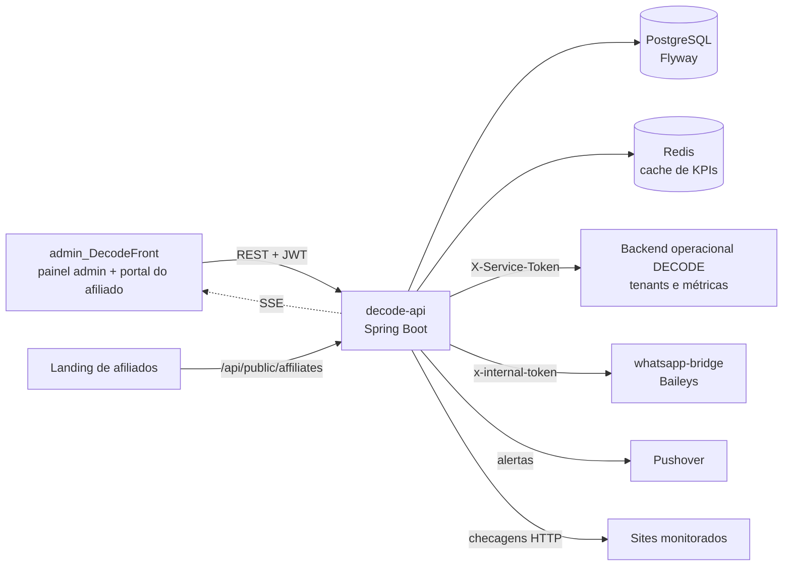

# DECODE Admin API

API REST do **painel administrativo do DECODE**, sistema de gestão para lanchonetes, restaurantes, pizzarias e outros estabelecimentos de alimentação. Esta API é usada pela equipe do DECODE para administrar o negócio por trás do produto: estabelecimentos clientes e seus planos por módulo (mesa, delivery ou completo), CRM comercial, programa de afiliados com comissões e pagamentos, tenants do backend operacional, monitoramento de sites e notificações via WhatsApp. Ela também expõe uma área isolada para o **portal do afiliado**.

O front-end que consome esta API está em **[admin_DecodeFront](https://github.com/LeandrSDEV/admin_DecodeFront)** (React + TypeScript + Vite).

        

---

## Funcionalidades

- **Clientes (decodes):** cadastro dos estabelecimentos clientes (nome, cidade, status ativo/pausado, nº de usuários, receita mensal), com vínculo a um afiliado e ao tenant correspondente no backend operacional.
- **Planos e assinaturas por módulo** (`MESA`, `DELIVERY`, `COMPLETA`): criação, renovação (expira a assinatura anterior do mesmo módulo), cancelamento com motivo, histórico por cliente e cálculo do modo de operação efetivo (`MESA`, `DELIVERY` ou `BOTH`). Ao criar ou renovar, a data de vencimento é sincronizada com o tenant.
- **CRM comercial:** leads (origem, estágio do funil, score, contato), resumo do pipeline por estágio, interações por canal (WhatsApp, Instagram, e-mail) com histórico de mensagens e fila por status.
- **Programa de afiliados:**
  - inscrição pública vinda da landing page e rastreamento de cliques por `refCode` (POST ou GET/pixel);
  - aprovação com senha inicial (marcada para troca no primeiro login), suspensão e reativação;
  - comissões mensais com taxa base, taxa bônus por volume de conversões, taxa personalizada por afiliado e período de carência;
  - *payout runs* com ciclo `DRAFT → REVIEWED → EXECUTING → COMPLETED` (ou `CANCELLED`) e registro do pagamento de cada comissão com referência do comprovante PIX.
- **Portal do afiliado** (autenticação própria): dashboard com indicações e estimativa do mês, histórico de comissões, CRM próprio (leads e interações isolados por afiliado) e envio de novos estabelecimentos fechados para aprovação.
- **Aprovação de estabelecimentos enviados por afiliados:** ao aprovar, a API cria o cliente, a assinatura e marca a indicação como convertida; ao rejeitar, registra o motivo e avisa o afiliado por WhatsApp.
- **Gestão de tenants** do backend operacional do DECODE (proxy servidor-a-servidor): listar, criar, editar, suspender e configurar tenants (tipo de estabelecimento, modo de operação, recursos habilitados).
- **Dashboard consolidado:** métricas operacionais dos tenants (vendas, pedidos, usuários), top 3 afiliados e totais do CRM em uma única chamada.
- **Monitoramento de sites:** checagens HTTP agendadas (padrão: a cada 60 s) com status `OK`/`SLOW`/`DOWN`, tempos de DNS, TLS e TTFB, validade do certificado SSL, detecção de endpoints Prometheus/Actuator, abertura e fechamento automático de incidentes e alertas via **Pushover** (queda, recuperação e SSL a vencer em até 14 dias).
- **Métricas do servidor** (CPU, memória, disco, uptime) coletadas periodicamente com **OSHI**.
- **Eventos e tempo real:** ingestão de eventos com payload sanitizado (chaves como senha, token, CPF e cartão são mascaradas), KPIs por janela de tempo (eventos/s, mensagens recebidas/enviadas, leads novos, falhas, latência média e p95) com cache curto em Redis, e transmissão via **Server-Sent Events**.
- **WhatsApp bridge:** controle da sessão Baileys dedicada do painel (status, conectar, novo QR Code, reiniciar, desconectar, logout), usada para enviar credenciais e avisos aos afiliados.
- **Usuários do painel:** CRUD restrito a administradores, perfis `ADMIN` e `OPERATOR`.
- **Consultas** de log de auditoria e de jobs, com filtros.

## Arquitetura

Aplicação Spring Boot em camadas, com pacote raiz `br.com.portal.decode_api`:

| Camada / pacote | Responsabilidade |
|---|---|
| `controller` | Endpoints REST, agrupados por domínio (`affiliate`, `tenant`, `events`, `realtime`, `audit`, `jobs`) |
| `service` | Regras de negócio, jobs agendados (`@Scheduled`), integrações HTTP e eventos de domínio (`@TransactionalEventListener` + `@Async`) |
| `repository` | Spring Data JPA; o *event store* usa `NamedParameterJdbcTemplate` com colunas `JSONB` |
| `entity` / `enums` | Modelo de dados JPA (UUIDs como chave) e enums de status |
| `dtos` | Contratos de entrada e saída (Java `record`) com Bean Validation |
| `security` | Duas *filter chains*, filtros JWT (painel e afiliado) e rate limit |
| `config` | `@ConfigurationProperties` (JWT, afiliados, WhatsApp bridge, rate limit) e OpenAPI |
| `exception` | `ApiExceptionHandler` centraliza as respostas de erro |

O schema é versionado com **Flyway** (`V1` a `V12`) e o Hibernate roda com `ddl-auto: validate`.

**Jobs agendados:**

| Job | Quando |
|---|---|
| Checagem dos sites monitorados | a cada `APP_MONITORING_POLL_INTERVAL_MS` (padrão 60 s) |
| Coleta de métricas do servidor | a cada 60 s |
| Geração das comissões do mês anterior | dia 1, às 03:00 |
| Aprovação de comissões após a carência | diariamente, às 04:00 |



## Endpoints principais

A documentação interativa completa fica em `/swagger-ui.html` (OpenAPI em `/v3/api-docs`).

**Legenda de acesso:** `Público` = sem token · `Autenticado` = JWT de usuário do painel · `ADMIN` = JWT com perfil ADMIN · `Afiliado` = JWT do portal do afiliado.

### Autenticação — `AuthController` (`Público` / `Autenticado`)

| Método | Rota | Descrição |
|---|---|---|
| POST | `/api/auth/login` | Login por e-mail e senha; retorna access token, refresh token e dados do usuário |
| POST | `/api/auth/refresh` | Troca o refresh token por um novo par (com rotação) |
| GET | `/api/auth/me` | Dados do usuário autenticado |

### Usuários — `UserAdminController` (`ADMIN`)

| Método | Rota | Descrição |
|---|---|---|
| GET | `/api/users` | Lista paginada de usuários do painel |
| POST | `/api/users` | Cria usuário |
| PUT | `/api/users/{id}` | Atualiza usuário |
| DELETE | `/api/users/{id}` | Remove usuário |

### Clientes — `DecodeController` (`Autenticado`)

| Método | Rota | Descrição |
|---|---|---|
| GET | `/api/decodes` | Lista paginada com busca (`q`) |
| POST | `/api/decodes` | Cadastra cliente (exige o afiliado responsável pela conversão) |
| PUT | `/api/decodes/{id}` | Atualiza cliente |
| DELETE | `/api/decodes/{id}` | Remove cliente |

### Assinaturas — `SubscriptionController` (`Autenticado`)

| Método | Rota | Descrição |
|---|---|---|
| GET | `/api/subscriptions` | Lista paginada com busca por cliente ou plano |
| GET | `/api/subscriptions/decode/{decodeId}` | Histórico de assinaturas de um cliente |
| GET | `/api/subscriptions/decode/{decodeId}/active-all` | Assinaturas ativas do cliente (uma por módulo) |
| GET | `/api/subscriptions/decode/{decodeId}/active/{module}` | Assinatura ativa de um módulo |
| GET | `/api/subscriptions/decode/{decodeId}/effective-mode` | Modo de operação efetivo (`MESA`/`DELIVERY`/`BOTH`) |
| POST | `/api/subscriptions` | Cria assinatura |
| POST | `/api/subscriptions/{id}/renew` | Renova (expira a anterior do mesmo módulo) |
| PATCH | `/api/subscriptions/{id}/cancel` | Cancela, com motivo opcional |
| DELETE | `/api/subscriptions/{id}` | Exclui o registro |

### CRM — `LeadController` e `InteractionController` (`Autenticado`)

| Método | Rota | Descrição |
|---|---|---|
| GET / POST | `/api/leads` | Lista paginada com busca / cria lead |
| PUT / DELETE | `/api/leads/{id}` | Atualiza / remove lead |
| GET | `/api/leads/pipeline` | Contagem de leads por estágio |
| GET / POST | `/api/interactions` | Lista paginada com busca / cria interação |
| PUT / DELETE | `/api/interactions/{id}` | Atualiza / remove interação |
| GET | `/api/interactions/queue` | Contagem de interações por status |
| GET / POST | `/api/interactions/{id}/messages` | Histórico / nova mensagem da interação |

### Afiliados (admin) — `AdminAffiliateController` (`ADMIN`)

| Método | Rota | Descrição |
|---|---|---|
| GET / POST | `/api/admin/affiliates` | Lista com filtro / cadastra afiliado |
| GET / PUT / DELETE | `/api/admin/affiliates/{id}` | Detalhe / atualiza / remove |
| POST | `/api/admin/affiliates/{id}/approve` | Aprova cadastro pendente com senha inicial |
| POST | `/api/admin/affiliates/{id}/suspend` · `/reactivate` | Suspende / reativa |
| GET | `/api/admin/affiliates/{id}/dashboard` | Mesmo dashboard que o afiliado vê no portal |
| GET | `/api/admin/affiliates/{id}/commissions` | Comissões do afiliado |
| GET | `/api/admin/affiliates/{id}/commissions/estimate` | Estimativa do mês corrente |
| POST | `/api/admin/affiliates/commissions/generate?month=AAAA-MM` | Gera as comissões de um mês |
| POST | `/api/admin/affiliates/commissions/{commissionId}/mark-paid` | Marca comissão como paga |
| GET / POST | `/api/admin/affiliates/payout-runs` | Lista / cria payout run do mês |
| GET | `/api/admin/affiliates/payout-runs/{runId}` · `/commissions` | Detalhe / comissões do run |
| POST | `/api/admin/affiliates/payout-runs/{runId}/review` · `/execute` · `/cancel` | Avança ou cancela o ciclo do run |

### Solicitações de estabelecimento — `AdminDecodeSubmissionController` (`ADMIN`)

| Método | Rota | Descrição |
|---|---|---|
| GET | `/api/admin/decode-submissions` | Lista com filtro por texto e status |
| GET | `/api/admin/decode-submissions/summary` | Quantidade de solicitações pendentes |
| GET | `/api/admin/decode-submissions/{id}` | Detalhe |
| POST | `/api/admin/decode-submissions/{id}/approve` | Aprova: cria cliente, assinatura e indicação convertida |
| POST | `/api/admin/decode-submissions/{id}/reject` | Rejeita com motivo e notifica o afiliado |

### Programa de afiliados (público) — `PublicAffiliateController` (`Público`)

| Método | Rota | Descrição |
|---|---|---|
| POST | `/api/public/affiliates/apply` | Inscrição de novo afiliado |
| POST / GET | `/api/public/affiliates/track` | Registra clique de indicação (`refCode`) |
| GET | `/api/public/affiliates/info` | Taxas, carência e URLs do programa |

### Portal do afiliado — `AffiliatePortalController` e `AffiliateCrmController` (`Afiliado`)

| Método | Rota | Descrição |
|---|---|---|
| POST | `/api/affiliate/auth/login` | Login do afiliado (público) |
| GET | `/api/affiliate/me` | Perfil, refCode, dados PIX e taxa de comissão |
| POST | `/api/affiliate/me/change-password` | Troca de senha |
| GET | `/api/affiliate/dashboard` · `/stats` | Dashboard e KPIs pessoais |
| GET | `/api/affiliate/commissions` | Histórico de comissões |
| GET / POST | `/api/affiliate/decode-submissions` | Lista / envia novo estabelecimento |
| GET / POST / PUT / DELETE | `/api/affiliate/leads[/{id}]` | CRM de leads do próprio afiliado |
| GET / POST / PUT / DELETE | `/api/affiliate/interactions[/{id}]` | Interações do próprio afiliado |

### Tenants — `TenantAdminController` (`ADMIN`)

| Método | Rota | Descrição |
|---|---|---|
| GET / POST | `/api/admin/tenants` | Lista / cria tenant no backend operacional |
| GET / PUT | `/api/admin/tenants/{id}` | Detalhe / atualiza |
| DELETE | `/api/admin/tenants/{id}` | Suspende o tenant |
| GET / PUT | `/api/admin/tenants/{id}/config` | Lê / altera a configuração do estabelecimento |

### Dashboards — `DashboardOverviewController` (`ADMIN`) e `DashboardController` (`Autenticado`)

| Método | Rota | Descrição |
|---|---|---|
| GET | `/api/admin/dashboard/overview` | Métricas dos tenants + top 3 afiliados + totais do CRM |
| GET | `/api/dashboard/summary` | Status da aplicação e resumo do monitoramento |
| GET | `/api/dashboard/kpis?window=5m` | KPIs de eventos na janela informada |

### Monitoramento — `MonitoringController` (`Autenticado`)

| Método | Rota | Descrição |
|---|---|---|
| GET | `/api/monitoring/summary` | Totais OK / lento / fora e incidentes abertos |
| GET / POST | `/api/monitoring/sites` | Lista / cadastra site |
| POST | `/api/monitoring/sites/quick` | Cadastro rápido |
| PUT / DELETE | `/api/monitoring/sites/{id}` | Atualiza / remove |
| POST | `/api/monitoring/sites/{id}/check` | Executa uma checagem imediata |
| GET | `/api/monitoring/sites/{id}/checks` · `/incidents` | Histórico de checagens / incidentes |
| GET | `/api/monitoring/system/overview` · `/samples` | Métricas atuais / série histórica do servidor |

### WhatsApp bridge — `AdminBridgeController` (`ADMIN`)

| Método | Rota | Descrição |
|---|---|---|
| GET | `/api/admin/bridge/status` | Estado da sessão (inclui QR Code quando aplicável) |
| POST | `/api/admin/bridge/connect` · `/restart` · `/new-qr` · `/disconnect` · `/logout` | Comandos de controle da sessão |

### Eventos, tempo real, auditoria e jobs (`Autenticado`)

| Método | Rota | Descrição |
|---|---|---|
| POST | `/api/events` | Ingere um evento (sanitizado) e o transmite via SSE |
| GET | `/api/events` | Lista eventos com filtros (período, tipo, canal, severidade, lead) |
| GET | `/api/realtime/stream` | Stream SSE de eventos |
| GET | `/api/audit` | Consulta o log de auditoria |
| GET | `/api/jobs` | Consulta jobs por fila e status |

Também ficam públicos: `/actuator/health`, `/actuator/info` e `/actuator/prometheus`.

## Segurança

- **Duas `SecurityFilterChain` independentes:**
  - `/api/affiliate/**` usa um filtro JWT próprio do afiliado: o token traz a claim `ptype=AFFILIATE`, recebe `ROLE_AFFILIATE` e só é aceito se o afiliado estiver `ACTIVE`;
  - as demais rotas usam o JWT dos usuários do painel.
- **JWT HMAC** (jjwt 0.13), sessão *stateless*. O segredo precisa ter no mínimo 32 bytes; chaves menores são rejeitadas ao assinar ou validar tokens. O afiliado pode usar segredo próprio (`APP_AFFILIATE_JWT_SECRET`).
- **Refresh token opaco:** 48 bytes aleatórios, armazenado apenas como hash SHA-256, com rotação a cada uso (o anterior é revogado e encadeado) e registro de IP e user agent. Validade padrão de 30 dias.
- **Senhas com BCrypt.**
- **Autorização por perfil:** `ADMIN` e `OPERATOR` para o painel; `@PreAuthorize("hasRole('ADMIN')")` em usuários, tenants, WhatsApp bridge, dashboard consolidado, afiliados (admin) e solicitações de estabelecimento.
- **Rate limit em memória por IP:** 12 tentativas de login por minuto e 25 requisições por segundo na API (configurável).
- **CORS** restrito à lista definida em `APP_CORS_ALLOWED_ORIGINS`.
- **SSE:** como o `EventSource` do navegador não envia headers, o token pode ir por query string apenas em `/api/realtime/**` (desligável com `APP_SSE_ALLOW_QUERY_TOKEN=false`).
- **Chamadas servidor-a-servidor** autenticadas por token compartilhado (`X-Service-Token` para o backend operacional, `x-internal-token` para o bridge). Os headers da resposta upstream não são repassados ao cliente.
- **Sanitização de eventos:** chaves sensíveis no payload são mascaradas, e strings e JSON grandes são truncados.

## Variáveis de ambiente

| Variável | Uso |
|---|---|
| `SPRING_PROFILES_ACTIVE` | Perfil ativo (`dev` por padrão, `prod` em produção) |
| `SPRING_DATASOURCE_URL` | URL JDBC do PostgreSQL |
| `SPRING_DATASOURCE_USERNAME` | Usuário do banco |
| `SPRING_DATASOURCE_PASSWORD` | Senha do banco |
| `SPRING_DATASOURCE_DRIVER_CLASS_NAME` | Driver JDBC (opcional) |
| `HIBERNATE_DIALECT` | Dialeto do Hibernate (opcional) |
| `SPRING_REDIS_HOST` | Host do Redis |
| `SPRING_REDIS_PORT` | Porta do Redis |
| `APP_JWT_SECRET` | **Obrigatória.** Segredo do JWT do painel (32+ bytes) |
| `APP_CORS_ALLOWED_ORIGINS` | Origens permitidas, separadas por vírgula |
| `APP_REFRESH_EXPIRATION_MS` | Validade do refresh token |
| `APP_SSE_ALLOW_QUERY_TOKEN` | Permite token por query string no SSE |
| `APP_RATE_LIMIT_ENABLED` | Liga/desliga o rate limit |
| `APP_RATE_LIMIT_LOGIN_PER_MINUTE` | Limite de logins por minuto por IP |
| `APP_RATE_LIMIT_API_PER_SECOND` | Limite de requisições por segundo por IP |
| `APP_MONITORING_POLL_INTERVAL_MS` | Intervalo das checagens de sites |
| `APP_PUSHOVER_ENABLED` | Liga os alertas Pushover |
| `APP_PUSHOVER_TOKEN` | Token da aplicação no Pushover |
| `APP_PUSHOVER_USER` | Chave do usuário no Pushover |
| `APP_AFFILIATE_BASE_RATE` | Taxa base de comissão (%) |
| `APP_AFFILIATE_BONUS_RATE` | Taxa bônus de comissão (%) |
| `APP_AFFILIATE_BONUS_THRESHOLD` | Conversões no mês para atingir a taxa bônus |
| `APP_AFFILIATE_CARENCIA_MONTHS` | Meses de carência antes de aprovar a comissão |
| `APP_AFFILIATE_JWT_SECRET` | Segredo do JWT do afiliado (usa `APP_JWT_SECRET` se vazio) |
| `APP_AFFILIATE_JWT_EXPIRATION_MS` | Validade do token do afiliado |
| `APP_AFFILIATE_PORTAL_BASE_URL` | URL do portal do afiliado (enviada na mensagem de boas-vindas) |
| `APP_AFFILIATE_LANDING_BASE_URL` | URL da landing usada nos links de indicação |
| `APP_WHATSAPP_BRIDGE_ENABLED` | Liga a integração com o bridge |
| `APP_WHATSAPP_BRIDGE_BASE_URL` | URL do whatsapp-bridge |
| `APP_WHATSAPP_BRIDGE_TOKEN` | Token interno do bridge |
| `APP_WHATSAPP_BRIDGE_INSTANCE` | Nome da sessão dedicada do painel |
| `APP_WHATSAPP_BRIDGE_CONNECT_TIMEOUT_MS` | Timeout de conexão |
| `APP_WHATSAPP_BRIDGE_READ_TIMEOUT_MS` | Timeout de leitura |
| `APP_WHATSAPP_BRIDGE_SEND_ATTEMPTS` | Tentativas de envio em falha de transporte |
| `APP_WHATSAPP_BRIDGE_SEND_RETRY_DELAY_MS` | Intervalo entre tentativas |
| `APP_TENANCY_BASE_URL` | URL do backend operacional (tenants e métricas) |
| `APP_TENANCY_SERVICE_TOKEN` | Token servidor-a-servidor do backend operacional |
| `JAVA_OPTS` | Opções da JVM no container |

> Nunca versione valores reais: o `.gitignore` já ignora `.env`, `application-local.yml` e `application-secrets.*`.

## Como rodar localmente

### Pré-requisitos

- JDK 21 (o Maven Wrapper já vem no repositório)
- PostgreSQL
- Redis (cache curto dos KPIs; o serviço de eventos tolera o Redis indisponível)
- Docker (opcional)

### 1. Subir banco e Redis (exemplo com Docker)

```bash
docker run -d --name decode-pg -p 5432:5432 \
  -e POSTGRES_DB=decode_admin -e POSTGRES_USER=decode -e POSTGRES_PASSWORD=<senha> \
  postgres:16

docker run -d --name decode-redis -p 6379:6379 redis:7
```

### 2. Configurar e executar

```bash
git clone https://github.com/LeandrSDEV/admin_DecodeBack.git
cd admin_DecodeBack

export SPRING_DATASOURCE_URL=jdbc:postgresql://localhost:5432/decode_admin
export SPRING_DATASOURCE_USERNAME=decode
export SPRING_DATASOURCE_PASSWORD=<senha>
export APP_JWT_SECRET=<segredo-com-32-bytes-ou-mais>

./mvnw spring-boot:run          # Windows: mvnw.cmd spring-boot:run
```

No Windows (PowerShell), defina as variáveis com `$env:NOME = "valor"`.

Na primeira execução o Flyway cria todo o schema. A migration `V2` cadastra um usuário administrador inicial; **troque a senha dele antes de expor o ambiente**.

| Recurso | URL |
|---|---|
| API | `http://localhost:8080` |
| Swagger UI | `http://localhost:8080/swagger-ui.html` |
| Health check | `http://localhost:8080/actuator/health` |
| Métricas Prometheus | `http://localhost:8080/actuator/prometheus` |

Para usar o front em `http://localhost:5173`, a origem já está no valor padrão de `APP_CORS_ALLOWED_ORIGINS`.

### 3. Testes

```bash
./mvnw test
```

São testes unitários com JUnit 5 e Mockito (serviços de clientes, leads, interações, usuários e o handler de exceções) e um `@WebMvcTest` do `DecodeController`. O teste `contextLoads` sobe o contexto completo e precisa do banco disponível.

### Docker

Build multi-stage (`maven:3.9.9-eclipse-temurin-21` para compilar, `eclipse-temurin:21-jre` para rodar):

```bash
docker build -t decode-api .
docker run --rm -p 8080:8080 \
  -e SPRING_PROFILES_ACTIVE=prod \
  -e SPRING_DATASOURCE_URL=jdbc:postgresql://<host>:5432/decode_admin \
  -e SPRING_DATASOURCE_USERNAME=decode \
  -e SPRING_DATASOURCE_PASSWORD=<senha> \
  -e SPRING_REDIS_HOST=<host-redis> \
  -e APP_JWT_SECRET=<segredo> \
  decode-api
```

## Estrutura de pastas

```text
admin_DecodeBack/
├── Dockerfile
├── pom.xml
├── mvnw / mvnw.cmd
└── src/
    ├── main/
    │   ├── java/br/com/portal/decode_api/
    │   │   ├── config/          # @ConfigurationProperties e OpenAPI
    │   │   ├── controller/      # REST: auth, decodes, leads, interactions, subscriptions,
    │   │   │   ├── affiliate/   #   monitoring, users, dashboard, bridge
    │   │   │   ├── tenant/      #   + afiliados (admin, portal, público), tenants,
    │   │   │   ├── events/      #     eventos, SSE, auditoria e jobs
    │   │   │   ├── realtime/
    │   │   │   ├── audit/
    │   │   │   └── jobs/
    │   │   ├── dtos/            # records de request/response
    │   │   ├── entity/          # entidades JPA
    │   │   ├── enums/           # status, papéis, módulos, canais
    │   │   ├── exception/       # ApiExceptionHandler e exceções de negócio
    │   │   ├── repository/      # Spring Data JPA
    │   │   ├── security/        # filter chains, JWT, rate limit (+ affiliate/)
    │   │   └── service/         # regras de negócio, jobs e integrações
    │   │       ├── affiliate/   #   comissões, payouts, indicações, notificações
    │   │       ├── events/      #   event store, sanitizer, SSE hub
    │   │       ├── tenant/      #   proxy de tenants e métricas
    │   │       └── whatsapp/    #   cliente do whatsapp-bridge
    │   └── resources/
    │       ├── application.yaml (+ -dev, -prod)
    │       └── db/migration/    # Flyway V1..V12
    └── test/                    # JUnit 5 + Mockito + MockMvc
```

## Projeto relacionado

- **Front-end:** [admin_DecodeFront](https://github.com/LeandrSDEV/admin_DecodeFront): painel administrativo e portal do afiliado em React + TypeScript + Vite.

---

Desenvolvido por **Leandro de Jesus Santos** · [LinkedIn](https://www.linkedin.com/in/leandro-js-santos/) · [Portfólio](https://leandrsdev.github.io/portfolio-web/)
